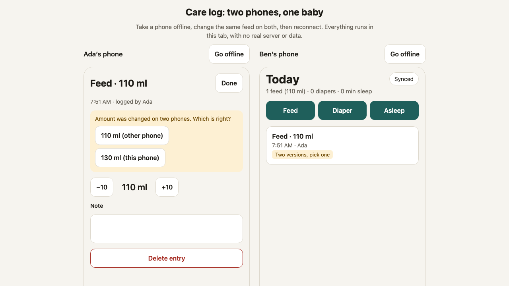

# care-log

An offline-first baby care log for two caregivers, built with Expo and React Native. Feeds, diapers and naps are saved on the phone first and synced when there is a network. When both people change the same thing while apart, the app keeps both versions and asks, instead of silently dropping one.



The web build is a demo of exactly that: two phones on one page, each with a "Go offline" button, running the real sync engine and the real server logic over a fake wire. Nothing leaves the tab.

## Why this problem

A baby log is used at 3 a.m., one-handed, by two tired people who are not in the same room. "Last write wins" is wrong here: if Ada logs 120 ml and Ben corrects it to 90, dropping either number without saying so is a real loss.

## How it works

```
 tap ─▶ op saved in SQLite ─▶ screen        phone A ──push──▶  server log  ──pull──▶ phone B
        (log and outbox are                  retries are       validate, order,     same pure
         the same table)                     safe: op ids      store; no merging    merge
```

- **Every edit is an op** (`set` some fields, or `delete`), stored before it is shown. The outbox is not a second table: it is the rows the server has not confirmed. One insert both records and queues an edit, so a crash cannot separate the two.
- **Conflicts are found causally, not by clock.** Each write names the writes it replaces (`base`). Two writes that did not know about each other are both kept as heads of that field, a multi-value register. State is made of sets that only grow, so ops can arrive in any order, any number of times.
- **Per field, not per record.** Editing the amount on one phone and the note on the other is not a conflict.
- **A delete removes only what its author had seen.** An edit made elsewhere at the same time brings the whole entry back and the app says why.
- **Clocks only pick which concurrent value is shown first** (hybrid logical clock). A phone set to tomorrow gets its ops sent back, corrects itself from the server's time, and restamps its queue, including its own references between ops.
- **The server never merges.** It validates, deduplicates by id, orders and stores. A reused id with a different body is refused, and one bad op does not sink its batch. Refused ops stay on the phone and the user is told.
- **If the server's log is lost,** its epoch changes and the phones upload everything again.
- **Sync** is single flight, with full-jitter backoff, `Retry-After`, request timeouts that include the body, and no retries on a refused token. It runs after an edit, on launch, on foreground, when the network returns, and every 30 seconds while open.
- **Domain rules are suggestions, not merges.** Two feeds from two phones within 10 minutes are marked "Logged twice?", since both may be real. Overlapping naps are counted once in the day total.

| Where | What |
|---|---|
| `src/core` | ops, merge, clock, timeline rules. Pure TypeScript |
| `src/sync` | engine, SQLite and memory stores, HTTP transport |
| `src/app`, `App.tsx`, `App.web.tsx` | React Native UI, native app, two-phone web demo |
| `server` | Node HTTP + SQLite sync server, no framework |

## Run it

```bash
npm install
npm run web                                   # the two-phone demo
TOKENS=secret:home npm run server             # sync server on :4020 (Node 24)
EXPO_PUBLIC_SYNC_URL=http://<your-ip>:4020 EXPO_PUBLIC_SYNC_TOKEN=secret EXPO_PUBLIC_CAREGIVER=Ada npm start
```

Without `EXPO_PUBLIC_SYNC_URL` the native app is a local-only log.

## How it was tested

- **96 core tests** (Vitest): merge properties with fast-check, the engine, both stores against one contract, and the server over real HTTP and SQLite.
- **A simulation** (one of the 96): three phones doing random things while requests and responses are lost, clocks jump by hours, apps are killed and the server is wiped. After reconnecting, all must show the same state and hold the same ops, and so must a newly installed phone. 300 histories locally, 3,000 in CI. It found a real bug while this was being written: an engine stopped in mid-request still wrote the late response into a store that another engine had taken over.
- **8 UI tests** (Jest, React Native Testing Library), including the conflict and delete-versus-edit flows.
- **12 browser runs** (4 Playwright specs on desktop, phone and dark phone) on the exported web build, with an axe WCAG A/AA scan. The build is read from disk by request interception.
- **32 deliberate breakages** of the source; 28 were caught at first, tests were added for the other 4, and now all 32 are.

```bash
npm test && npm run build:web && npm run test:e2e
```

## Honest limits

- **Not yet run on a device or simulator.** The iOS and Android bundles build and the SQL is tested through `node:sqlite`, but `expo-sqlite` itself, background behaviour and VoiceOver/TalkBack are unverified.
- The web demo keeps everything in memory. It is not an offline web app.
- The op log is never compacted and is read into memory at launch. Fine for a household, not for years of heavy use.
- Auth is one static token per household, built into the app. No sign-up, invites or encryption at rest. Do not put real data on it.
- Sync happens while the app is open. There is no background fetch or push, and the server has no rate limit.
- Conflict buttons say "this phone" and "other phone"; with three phones, "other" is ambiguous.
- An older app that pulls an op kind it does not know stops syncing with an error until it is updated.
- `at` is recorded from the phone's clock. If that clock was wrong before the first sync, the stamp is corrected but the entry's displayed time is not.
